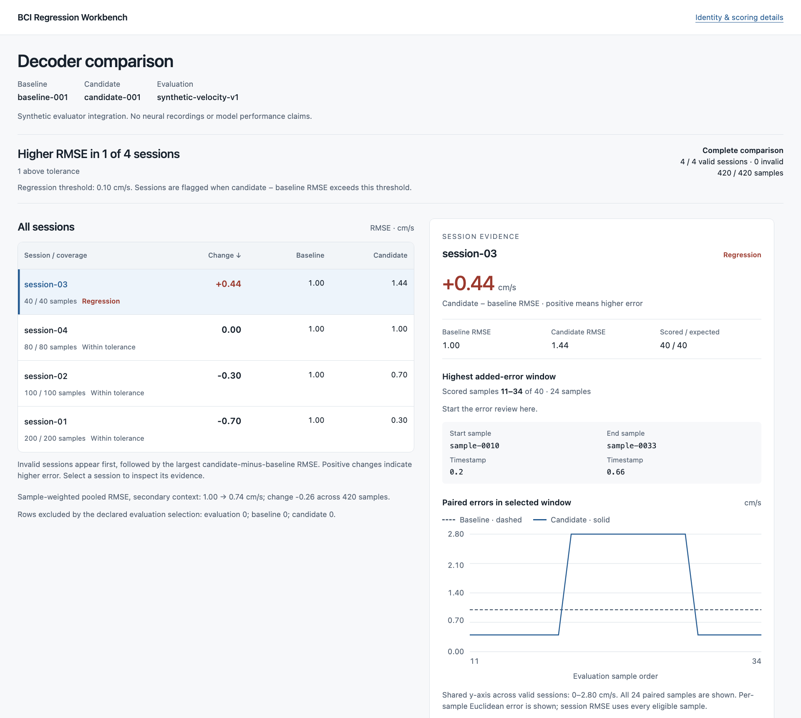

# BCI Regression Workbench

[](https://github.com/logannye/bci-regression-workbench/actions/workflows/tests.yml)
[](https://logannye.github.io/bci-regression-workbench/)
[](pyproject.toml)
[](LICENSE)

**A Python library that compares saved baseline and candidate BCI decoder predictions in an interactive, session-by-session report.**

Use it at the end of an offline evaluation job to find recording days that got worse, even when the average score improved. Select a session to locate the window with the most added error, then use its sample IDs and timestamps in your existing analysis tools.



*Synthetic example, produced by the [commands below](#run-the-synthetic-example). Pooled RMSE falls from 1.00 to 0.74 cm/s while `session-03` rises from 1.00 to 1.44 and is flagged. The human and macaque demos apply the same report to real recordings; neither contains a session that got worse.*

### [Explore the human BCI demo →](https://logannye.github.io/bci-regression-workbench/)

Open the completed comparison in your browser. Select a recording day to inspect baseline and candidate errors side by side.

| Inputs | Outputs |
| --- | --- |
| Two-dimensional reference labels, sample eligibility, and baseline/candidate predictions keyed by session and sample | An interactive HTML report, session-score CSV, and saved inputs for reproducing the scores |

**Existing evaluator → saved predictions → session comparison → investigate changed sessions.** Pin the baseline and column mapping once; each candidate evaluation writes its own report. Both decoders are scored on the same declared samples using two-dimensional vector RMSE.

An independent open-source project by Logan Nye for BCI ML evaluation. The library, both demos and their validation were built in a single day, October 28, 2026, with an AI coding agent (OpenAI Codex); the pull requests and the receipts under [`docs/`](docs/) record each step.

## Read the demo

1. **Check the Change column.** Candidate minus baseline RMSE: positive means higher error, negative means lower error. Coverage shows scored versus expected samples.
2. **Select a session.** The evidence pane locates the 24-scored-sample window with the largest positive net increase in squared error, when one exists, with a paired error trace and exact sample references. An improved session can still contain a local loss.
3. **Inspect the details.** Expand **Supporting samples**, **Full-session trace**, or **Identity & scoring details**. See the [localization rule](docs/LOCALIZATION.md) for window selection and gap handling.

The human demo uses **MINDFUL T11**, public implanted-BCI recordings from one person performing a cursor task. Two fixed ridge decoders train on the earliest three days and evaluate on **all twelve later days: 324,732 samples**. The baseline uses the current neural bin; the candidate adds three previous bins. The [evaluation plan](docs/human-demo/PLAN.md) was frozen before fitting.

The candidate has lower RMSE on all twelve days. Pooled RMSE decreased from **0.4297 to 0.4119** dataset coordinate units. Every expected sample was scored, saved scores reproduced, and an independent audit checked source files, masks, predictions, and arithmetic. [Results](docs/human-demo/RESULTS.md) · [Audit](docs/human-demo/audit-v1.json) · [Reproduction](docs/human-demo/REPRODUCE.md)

**Target meaning:** labels are inferred cursor-to-target displacement vectors, a movement proxy rather than measured intended velocity. RMSE measures agreement with that proxy. Live control quality requires closed-loop testing; the released neural features also use noncausal preprocessing. These are two offline example decoders.

Also available: the [Indy macaque report](https://logannye.github.io/bci-regression-workbench/indy/) and its [results](docs/public-demo/RESULTS.md). The synthetic example below includes a worsened session despite an improved average.

## Install

```sh
python3 -m pip install "git+https://github.com/logannye/bci-regression-workbench.git@v0.1.0"
```

Python 3.10 or later, in a virtual environment. The core has no third-party dependencies.

## Run the synthetic example

The example lives in the repository. From a clone, in an environment with the package installed (`python3 -m pip install .`), using a fresh output directory:

```sh
python3 examples/basic_comparison.py --output-dir runs/demo --initialize
python3 examples/basic_comparison.py --output-dir runs/demo
python3 examples/basic_comparison.py --output-dir runs/demo --candidate-id candidate-002
```

The core uses Python's standard library. Initialization saves the reference once; the next two commands reuse it for separate candidate reports and verify score reproduction. Open the printed report path and select the worsened session. Use a new output directory or candidate ID for each new comparison. To run from a clone without installing, prefix each command with `PYTHONPATH=src`.

## Add it to an evaluation job

Construct an `EvaluationSet` from the job's actual labels, sample keys, timestamps, and eligibility, and export baseline predictions bound to that evaluation. Map your evaluator's column names once when creating the reference:

```python
from bci_regression.pinned import PinnedComparison

# Once, using exports from the baseline evaluation:
PinnedComparison.create(
    "references/reaching-v1",
    evaluation=baseline_evaluation,
    baseline=baseline_export,
    prediction_columns={"session_id": "recording", "sample_id": "bin",
                        "predicted_vx": "vx", "predicted_vy": "vy"},
    tolerance=0.1,  # Absolute RMSE increase in the declared units
)

# Each candidate evaluation:
check = PinnedComparison.load("references/reaching-v1")
result = check.compare(
    candidate_outputs, evaluation=current_evaluation,
    run_id=run_id, output_dir=job_dir / "session-regressions",
    provenance=run_metadata,
)
```

These variables represent your evaluator's exports; the [executable example](examples/basic_comparison.py) supplies them end to end. Build `current_evaluation` independently from the current job. The hook rejects a changed evaluation identity; new labels, eligibility, or settings require a new reference. Missing, duplicate, or nonfinite predictions appear as invalid sessions.

Use `tolerance=None` for descriptive differences, as in the public demos. The default target kind is velocity. For inferred displacement, declare `target_kind="inferred_cursor_to_target_vector"` and the coordinate units on the evaluation. See the [input contract](docs/EVALUATION.md) and [integration workflow](docs/WORKFLOW.md).

The optional [datarepo example](examples/datarepo_example.py) reads synthetic prediction tables through Neuralink's [datarepo](https://github.com/neuralinkcorp/datarepo) Parquet interface. Its [dependencies](requirements-datarepo.txt) and real Arrow/Parquet integration are tested separately from the core.

## Reproduce a comparison

Each comparison saves `report.html`, `session_metrics.csv`, and JSON files containing the evaluation, predictions, results, and provenance. Retain the bundle with its recorded source revision, including the renderer.

```python
from bci_regression import reproduce

result = reproduce("runs/demo/candidate-001/session-regressions")
print(result["complete"])
```

Reproduction verifies artifact identities and recomputes scores from saved predictions and labels. Prediction generation and training provenance belong to the evaluator. The hosted demos contain bounded previews and aggregate scores; full reproduction uses the saved bundle.

## Validation and development

**Status: working prototype.** Public-data audits, scoring reproduction, browser checks, core tests, and optional datarepo integration have passed their [recorded validation](docs/human-demo/validation-v1.json). Evaluation with Neuralink engineers is the next usability step.

Run the core checks with:

```sh
PYTHONPATH=src python3 -m unittest discover -s tests -v
```

[Design](docs/DESIGN.md) · [Evaluation contract](docs/EVALUATION.md) · [Sources and assumptions](docs/SOURCES.md) · [Contributor instructions](AGENTS.md)

## License

[MIT](LICENSE). Dependency and dataset licenses apply separately.
